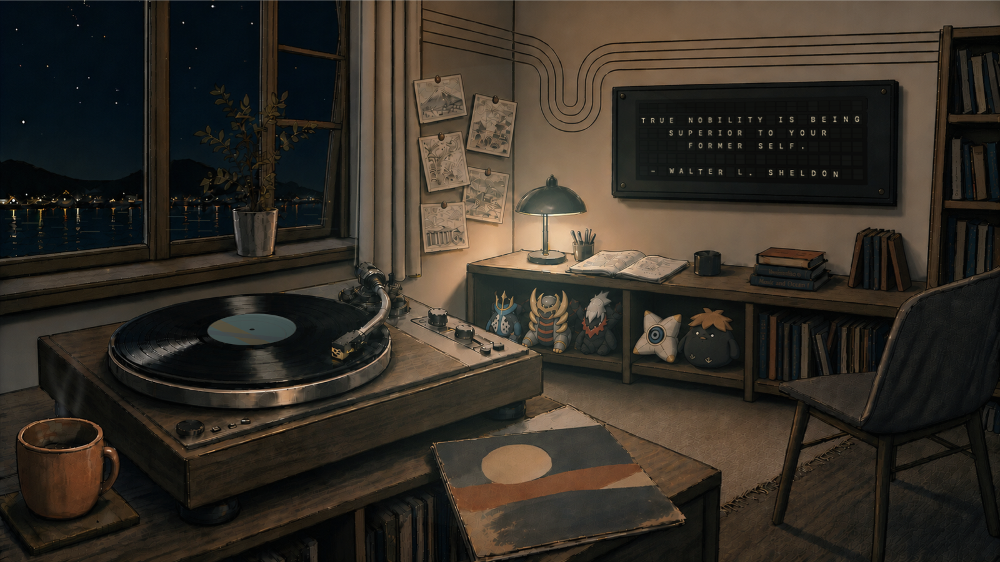

# Vinyl Scene

A tactile, music-responsive desktop scene for macOS.

Vinyl Scene turns your desktop into an illustrated listening space. It can read the
currently playing track from Apple Music or Spotify, then coordinate the split-flap
board, record label, lamp color, and restrained environmental motion around the music.

> **Friend beta:** Version 0.1.0 is an unnotarized Apple Silicon preview. macOS will ask
> you to manually approve it the first time you open it. See the installation steps below.

[Download the latest friend beta](https://github.com/shebabaloo/vinyl-scene/releases/latest)

## The scenes

### Listening Room

The public default: a warm night room with a six-row split-flap board, album-derived
lighting, record movement, coffee steam, and quiet window life. When live music is idle,
the board reads **WELCOME TO THE LISTENING ROOM!**

### Desk Loop

A top-down daytime desk with a large animated record, printed track card, album-colored
lamp response, environmental shadow, and coffee steam.

### Shez's Listening Room

The bundled personalization example. It demonstrates how the same board, record, lamp,
steam, and window system can support a more personal room. When music is idle, this
edition rotates through a curated quote deck.

## Requirements

- A Mac with Apple Silicon: M1, M2, M3, M4, or newer
- macOS 14 Sonoma or later
- Apple Music or Spotify only if you want live now-playing information

Intel Macs are not supported by this beta.

## Install the friend beta

1. Open [Releases](https://github.com/shebabaloo/vinyl-scene/releases) and download
   `Vinyl-Scene-0.1.0-friend-beta-arm64.zip`.
2. Double-click the ZIP and move **Vinyl Scene.app** into your Applications folder.
3. Try to open Vinyl Scene once. macOS will warn that the developer cannot be verified.
4. Open **System Settings → Privacy & Security**, scroll to **Security**, and choose
   **Open Anyway** for Vinyl Scene.
5. Confirm **Open** when macOS asks again.

Only use the security override for a build downloaded from this repository. The SHA-256
checksum published with the release lets you verify the ZIP before opening it.

## First use

1. Choose Listening Room or Desk Loop. Listening Room also offers the Shez example.
2. Choose **Preview** to explore without connecting a music app, or **Live music** to read
   the currently playing title and artist from Apple Music or Spotify.
3. Choose a motion level:
   - **Still** freezes physical movement.
   - **Quietly alive** keeps calm, restrained movement.
   - **Expressive** makes the ambient movement more visible without beat pulsing.
4. Choose **Follow album** or a persistent **Fixed color**, then an optional color
   treatment.
5. Choose your display and select **Use on [display]**.

The menu-bar record icon always lets you return to the editor, show the normal wallpaper,
rerun setup, or quit.

### Music and Spotify permission

Live music is optional. The first time Vinyl Scene reads Apple Music or Spotify, macOS may
ask for Automation permission. If it was denied, use **Open Automation Settings** inside
Vinyl Scene, enable the relevant music app, and return to Vinyl Scene.

## Personalize a room

Listening Room includes a local Creator Kit. Choose **Create your own Listening Room**,
export a starter, personalize its fixed room plate with Codex or Claude, then import the
finished Scene Pack. Working references and intermediate images remain in the folder you
choose; the app installs only the validated final plate and manifest.

## Privacy

Vinyl Scene has no accounts, advertising, telemetry, or analytics. Now-playing metadata
is read locally through macOS Automation. See [PRIVACY.md](PRIVACY.md) for the complete
friend-beta data boundary.

## Known beta limitations

- This build is not signed with an Apple Developer ID and is not notarized, so first launch
  requires the manual **Open Anyway** flow.
- Apple Silicon only; no Intel build is included.
- Live now-playing support is limited to Apple Music and Spotify.
- Scene Pack v1 replaces a fixed Listening Room illustration; it is not a freeform layout
  editor.

## Help and feedback

Use [GitHub Issues](https://github.com/shebabaloo/vinyl-scene/issues) for reproducible bugs
or installation problems. Include your Mac model, macOS version, selected scene, motion
mode, and whether you were using Preview, Apple Music, or Spotify. Do not attach private
Scene Pack references.

## Repository boundary

This is a release-and-support repository. The application source is not published here,
and the bundled illustrations are not licensed for reuse outside Vinyl Scene. See
[TERMS.md](TERMS.md).
