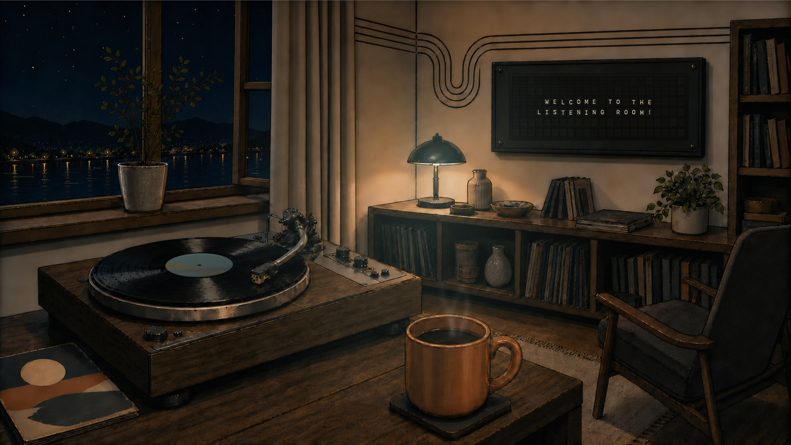

# Vinyl Scene

A tactile, music-responsive desktop scene for macOS.

Vinyl Scene turns your desktop into an illustrated listening space. It reads the currently
playing track from the Spotify or Music Mac app, then coordinates the split-flap board or
printed track card, record label, lamp color and restrained ambient motion around the
music. It does not play audio itself.

> **Beta:** Version 0.1.6 is an unnotarized Apple Silicon preview. macOS asks you to
> approve it once, the first time you open it.

## Download and install

### [Download Vinyl Scene Beta for Apple Silicon (7.4 MB)](https://github.com/shebabaloo/vinyl-scene/releases/download/v0.1.6-beta/Vinyl-Scene-Beta-0.1.6-build7-arm64.zip)

Requires an Apple Silicon Mac (M1 or newer) running macOS 14 Sonoma or later. Intel Macs
are not supported by this beta.

1. Click the download link above, then double-click the ZIP.
2. Move **Vinyl Scene Beta.app** into your **Applications** folder.
3. Open it. macOS says it cannot check the app. Click **Done**, not Move to Trash.
4. Open **System Settings → Privacy & Security**, scroll to **Security**, click
   **Open Anyway** next to "Vinyl Scene Beta", and confirm with your password or Touch ID.
   Click **Open Anyway** again if asked.
5. Keep the app in Applications. Run straight from Downloads, macOS can ask again on the
   next launch.

If you are looking at GitHub's **Assets** list, choose
`Vinyl-Scene-Beta-0.1.6-build7-arm64.zip`. Do **not** choose either automatically generated
**Source code** archive; those files do not contain the app.

Only use the security override for a build downloaded from this repository. The SHA-256
checksum published with the [release](https://github.com/shebabaloo/vinyl-scene/releases/tag/v0.1.6-beta)
lets you verify the ZIP before opening it.

**Installed the 0.1.0 friend beta?** It is a separate app named Vinyl Scene. Run one at a
time. To remove it, turn off its Start at login if you enabled it, quit it, and move
**Vinyl Scene.app** to Trash.

## The scenes

### Listening Room

A warm night room with a six-row split-flap board, album-derived lighting, record
movement, coffee steam and quiet window life. When live music is idle, the board reads
**WELCOME TO THE LISTENING ROOM!**

### Desk Loop

A top-down desk with a large animated record, a printed track card, album-colored lamp
response, environmental shadow and coffee steam.

## First use

1. Choose **Listening Room** or **Desk Loop**.
2. Choose **Preview** to explore without connecting a music app, or **Live music** to follow
   the song playing in the Spotify or Music Mac app.
3. Choose **Use on [display]** to place the scene on your desktop.

**Open editor** holds the rest, and choices save automatically:

- **Motion:** **Still** freezes physical movement, **Quietly alive** keeps calm movement,
  and **Expressive** (the default) makes the ambient movement more visible. Motion is
  time-based, not synced to the beat. Still keeps song details and colors updating, and
  macOS Reduce Motion switches to Still.
- **Color:** **Follow album** or a persistent **Fixed color**, chosen on a spectrum strip.
- **More options:** a color treatment (Natural, Muted, Warm or Nocturne), **Open straight
  to desktop** and **Start at login**.

The menu-bar record icon always lets you return to the editor, show the normal wallpaper,
rerun setup or quit.

Vinyl Scene pauses its animation clocks when the scene is fully covered, the screen is
asleep or the macOS session is inactive, and catches up when it is visible again.

### Music and Spotify permission

Live music is optional. The first time Vinyl Scene reads Apple Music or Spotify, macOS may
ask for Automation permission. If it was denied, use **Open Automation Settings** inside
Vinyl Scene, enable the relevant music app, and return to Vinyl Scene. Spotify takes
priority when both apps are playing.

## Privacy

Vinyl Scene has no accounts, advertising, telemetry or analytics. Now-playing metadata is
read locally through macOS Automation. See [PRIVACY.md](PRIVACY.md) for the complete beta
data boundary.

## Known beta limitations

- This build is not signed with an Apple Developer ID and is not notarized, so first launch
  requires the manual **Open Anyway** flow.
- Apple Silicon only; no Intel build is included.
- Live now-playing support is limited to the Spotify and Music Mac apps. Spotify album
  covers set the colors; Apple Music uses song-inspired fallback colors.
- This beta includes two scenes. Personal rooms and the Creator Kit from 0.1.0 are not
  part of it.

## Help and feedback

Use [GitHub Issues](https://github.com/shebabaloo/vinyl-scene/issues) for reproducible bugs
or installation problems. Include your Mac model, macOS version, selected scene, motion
mode, and whether you were using Preview, Apple Music or Spotify.

## Repository boundary

This is a release-and-support repository. The application source is not published here,
and the bundled illustrations are not licensed for reuse outside Vinyl Scene. See
[TERMS.md](TERMS.md).
